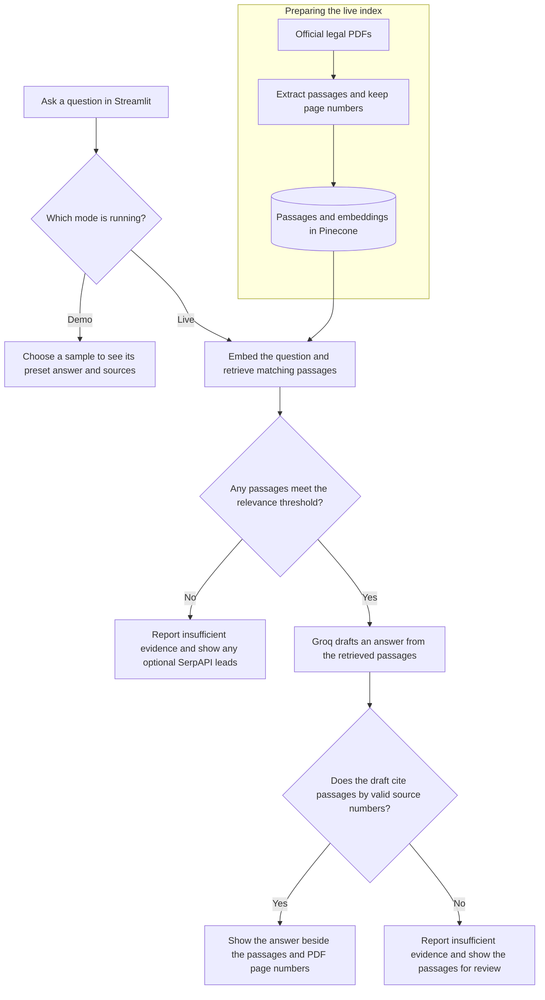

# Kuku AI Generalist Assignment

[Original assignment and problem statements](Kuku%20%E2%80%94%20AI%20Generalist%20Assignment%20%281%29.pdf)

| Problem | Project | Submission |
| --- | --- | --- |
| 1 | [Find the Promos](problem-1-find-the-promos/) | [Solution, prototype ZIP, worksheet and raw outputs](problem-1-find-the-promos/submission/) |
| 2 | [Lawyer Up AI](problem-2-lawyer-up-ai/code/) | [Solution, prototype ZIP, worksheet and raw outputs](problem-2-lawyer-up-ai/submission/) |
| 3 | [Slate Check](problem-3-slate-check/) | [Solution, prototype ZIP, worksheet and raw outputs](problem-3-slate-check/submission/) |

Problem 2 also includes the [original blank worksheet](problem-2-lawyer-up-ai/submission-template/Form%20worksheet.md).

## Problem 1 — Find the Promos

Run the commands in this section from the project directory. From the repository root, enter it with

```sh
cd problems/problem-1-find-the-promos
```

A Python CLI for Kuku's AI Generalist Assignment, Problem 1. It helps an editor find 20 to 60 seconds of existing footage that could introduce a microdrama to a first-time viewer on Instagram, TikTok or YouTube. Each recommendation gives the episode, exact cut points, opening hook, unresolved ending and reason to post it. For a stitched promo, the segments are listed in playback order.

**Start with the completed run.** The tool processed 50 episodes and returned 10 picks from eight episodes. Nine are continuous cuts and one joins two segments. The assignment report explains the approach and audits the top pick. [Ranked promos](problem-1-find-the-promos/out-full/promos.md) · [Two-page solution report](problem-1-find-the-promos/submission-report/Find%20the%20Promos%20-%20Solution%20Report.pdf)

### Run the sample

Use Python 3.12 or newer. The sample contains three original episodes and can be shared for demonstrations.

```sh
python3 -m venv .venv
. .venv/bin/activate
python -m pip install -r requirements.txt
```

Choose a provider and set its key in the same terminal. The CLI reads environment variables directly.

| `PROVIDER` | API key variable | Default model |
|---|---|---|
| `openai` (default) | `OPENAI_API_KEY` | `gpt-4.1-mini` |
| `anthropic` | `ANTHROPIC_API_KEY` | `claude-haiku-4-5` |

For example, in zsh, enter an OpenAI key without displaying it or saving it in command history:

```zsh
export PROVIDER=openai
read -rs 'OPENAI_API_KEY?Paste your OpenAI API key and press Enter: '
export OPENAI_API_KEY
python find_promos.py sample_screenplay.txt --out runs/sample --top 10
```

Set `MODEL` to override the selected provider's default. Choose a model that supports temperature control. The default output directory is `out/`, and the default shortlist size is 10. Use a fresh output directory for each run because the CLI replaces its reports, including the evaluation sheet.

### Supply a screenplay

Pass one UTF-8 text file. The parser accepts bracketed timestamps such as `[00:12] LENA: Who sent this?`, plain `mm:ss` or `hh:mm:ss` entries, SRT cues, and Kuku's native timestamped action and dialogue blocks. Episode headers include `EPISODE 1`, `Episode 2` and `# Ep 3`. Times are local to each episode.

Untimed text following a timestamp continues the current entry. Each entry ends at the next distinct start time. Without an explicit final end, the parser estimates the last entry's length. For a fully untimed episode it uses 2.5 words per second, with a minimum of 1.5 seconds per line. Cuts using inferred times carry `timing_estimated: true`.

```sh
season_file=$(mktemp)
for episode in "I Married a Broken Soldier. He was a Duke"/episode-*.txt; do
  cat "$episode"
  printf '\n'
done > "$season_file"
python find_promos.py "$season_file" --out runs/full-season --top 10
rm "$season_file"
```

The selected API provider receives screenplay text. Keep Kuku's source pack out of public repositories and shared demos.

### How selection works

1. **Parse.** `parser.py` creates an episode-local timeline of indexed screenplay lines and groups camera, action and dialogue entries with the same start time.
2. **Propose.** Using the instructions in `prompts.py`, the model summarizes each episode and suggests up to five continuous cuts. A second pass sees all episodes, uses compact excerpts for larger inputs, and proposes up to five promos of two or three segments.
3. **Validate.** `find_promos.py` checks episode IDs, inclusive line ranges, segment overlap and total duration. For stitched clips, duration is the sum of the selected segments.
4. **Critique.** A separate prompt scores hook, cliffhanger and standalone clarity from 1 to 10. It receives the selected text in playback order, an approximate first-three-second excerpt and up to three unseen lines after the final cut.
5. **Rank.** The score weights hook at 40%, cliffhanger at 30% and standalone clarity at 30%. A weak opening costs one point, immediate resolution costs two, and spoiling a major twist costs one. Higher-scoring promos claim their source footage first. The CLI returns the top remaining cuts.

`llm.py` handles both official SDKs and retries malformed JSON once. Calls run sequentially: one per episode, one stitching call, then one critique per valid candidate. Lowering `--top` shortens the final list without reducing critique calls. Provider charges depend on the model and usage. Failed responses are logged so other candidates can still be processed.

### Read and evaluate a run

| Output from the full run | Use |
|---|---|
| [promos.md](problem-1-find-the-promos/out-full/promos.md) | Read the ranked shortlist and the reason the first pick leads. |
| [promos.json](problem-1-find-the-promos/out-full/promos.json) | Retrieve episode-local timestamps, playback order, duration, scores, critic flags and timing confidence. |
| [quality_report.md](problem-1-find-the-promos/out-full/quality_report.md) | Inspect rejected ranges, failed model responses, duplicates, episode coverage and critic issues. |
| [eval_sheet.csv](problem-1-find-the-promos/out-full/eval_sheet.csv) | Record a human posting decision for each cut. |

Of 250 proposals in the full run, 95 failed duration checks, 62 failed index checks, six were dropped as duplicates and 77 fell below the top ten. The report recorded zero LLM JSON failures. Editorial scores still need human review. For example, the first pick starts at 02:30.500 in episode 36, but the spoken warning credited as its hook starts at 02:33.500. An editor should preview what the viewer actually hears in those first three seconds.

To evaluate the shortlist, copy the CSV, hide `tool_score`, and preview each cut as a new viewer. Rate the hook, cliffhanger and standalone clarity from 1 (weak) to 5 (strong). Enter Y or N for `would_post(Y/N)` and use `failure_type` and `notes` to identify the exact moment behind the decision. The saved full-run sheet has blank human ratings.

### Test without an API key

```sh
python -m pytest -q
python -m pytest -q tests/test_validation.py::test_sample_cli
```

The suite covers parsing, time estimation, validation, scoring, JSON retry and recovery from a failed episode call. The second command runs the sample through the CLI entry point with mocked model responses and verifies all four output files.

## Problem 2 — Lawyer Up AI

Run the commands in this section from the project directory. From the repository root, enter it with

```sh
cd problems/problem-2-lawyer-up-ai/code
```

`lawyer_up_ai` is a Streamlit workspace for researching Indian law. Ask a question and inspect the retrieved passages alongside the answer. Sources show the PDF filename and page number, with links to the official PDFs in the starter collection.

### Project flowchart



### Quick start

Use Python 3.11 or 3.12. Run these commands from the project directory on macOS or Linux:

```bash
python3.12 -m venv .venv
source .venv/bin/activate
python -m pip install -r requirement.txt
streamlit run streamlit_app.py
```

Open [the local workspace](http://127.0.0.1:8501) and choose a sample question. The demo uses preset answers and runs without API keys.

### Live research

#### Configure API keys

Copy the template to `.env` if you do not already have one:

```bash
cp -n .env.example .env
```

| Variable | Purpose |
| --- | --- |
| `GROQ_API_KEY` | Required. Generates answers from retrieved passages. |
| `PINECONE_API_KEY` | Required. Stores and retrieves passage embeddings. |
| `SERPAPI_API_KEY` | Optional. Finds links to official resources when indexed evidence is weak. |
| `GROQ_MODEL` | Selects the generation model. Defaults to `openai/gpt-oss-120b`. |
| `PINECONE_INDEX` | Names the vector index. Defaults to `law-suggestion-index`. |
| `PINECONE_NAMESPACE` | Names the corpus within the index. Defaults to `lexai-v1`. |

Fill in your API keys in `.env`. Git ignores this file.

#### Download and index the corpus

Run the first code cell in [agent.ipynb](problem-2-lawyer-up-ai/code/agent.ipynb) or use the Python command below. Both fetch the same eight official PDFs into `data/legal/`. The collection includes the Bharatiya Nyaya Sanhita, 2023, and Acts covering topics such as dowry, workplace harassment, and domestic violence. The source URLs are listed in [download_sources.py](problem-2-lawyer-up-ai/code/download_sources.py).

```bash
python download_sources.py
python ingest.py data/legal --ocr
```

The `--ocr` flag lets the indexer read scanned pages and requires Tesseract with English language data. The first indexing run downloads the embedding model. The indexer creates the configured Pinecone index if needed, and uploaded passages may take a short time to become searchable.

To add more legislation, place public PDFs in `data/legal/` with descriptive filenames. Re-running ingestion with identical files updates the existing records. When replacing or removing PDFs, index the revised collection into a fresh `PINECONE_NAMESPACE` and restart the app with that namespace.

#### Start Streamlit

Stop the demo first if it is using port 8501, then run:

```bash
streamlit run streamlit_app.py -- --live
```

Try asking **Under which section of the Bharatiya Nyaya Sanhita, 2023 is theft defined?** Open the linked PDF in the evidence panel to check the cited page.

### How it works

1. The indexer splits PDFs into passages, preserves their page numbers, and stores 384-dimensional embeddings in Pinecone.
2. The app embeds each question and retrieves relevant passages. If the question names an Act from the starter collection, it also searches within that Act.
3. Groq generates an answer using the retrieved passages and cites them by number. The app reports insufficient evidence if the retrieval is weak or the answer lacks valid source references. Optional SerpAPI results appear as research leads.
4. Streamlit displays the answer and evidence together. Passages extracted by OCR are labeled so you can compare the transcription with the original page.

Citation checks confirm that the answer points to a retrieved source. Verify that each cited passage supports the claim and that the law applies to the relevant place and date. This project provides general legal information. Consult a qualified lawyer for advice about your situation.

Live mode sends the question and selected excerpts to Groq and the query embedding to Pinecone. When enabled, SerpAPI receives the question on the search fallback. Leave out names, contact details, and other personal information.

### Project files

| File | Purpose |
| --- | --- |
| [streamlit_app.py](problem-2-lawyer-up-ai/code/streamlit_app.py) | Question form, answer, and evidence panel |
| [research.py](problem-2-lawyer-up-ai/code/research.py) | Evidence filtering, citation checks, and demo responses |
| [providers.py](problem-2-lawyer-up-ai/code/providers.py) | Pinecone retrieval, Groq generation, and optional web search |
| [download_sources.py](problem-2-lawyer-up-ai/code/download_sources.py) | Official source URLs and PDF downloads |
| [ingest.py](problem-2-lawyer-up-ai/code/ingest.py) | PDF text extraction, OCR, and vector indexing |
| [agent.ipynb](problem-2-lawyer-up-ai/code/agent.ipynb) | PDF download cell and original LangGraph retrieval experiment |

### Tests

```bash
python -m unittest discover -s tests
```

The tests cover the Streamlit demo, blank input validation, and how the research pipeline handles weak evidence and missing citations.

### Roadmap

1. Build a lawyer-reviewed evaluation set for citation accuracy, jurisdiction, and effective dates.
2. Add exact Act and section lookup and measure it against semantic retrieval.
3. Track the versions and dates of source documents before expanding coverage.

## Problem 3 — Slate Check

Run the commands in this section from the project directory. From the repository root, enter it with

```sh
cd problems/problem-3-slate-check
```

A commissioning editor can audit a batch of US vertical microdrama loglines before sending them to script. Start with [the solution brief](problem-3-slate-check/solution.pdf), [research and sources](problem-3-slate-check/RESEARCH.md), or the [unedited demo output](problem-3-slate-check/raw_outputs/sample-report.md).

### Run Slate Check

Python 3.9+ with its standard library. The demo uses six original pitches and saved AI-authored annotations and alternatives. Scoring, validation, ranking and rendering run on each invocation.

```sh
python3 -B -m slate --demo
python3 -B -m slate --demo --output raw_outputs/sample-report.md
python3 -B -m unittest discover -s tests -v
```

For new pitches, set OPENAI_API_KEY in your shell. MODEL optionally overrides gpt-4.1-mini. Live mode sends only the selected inputs and instructions to OpenAI. Supply one complete pitch per nonblank line. For optional dialogue checks, pass repeatable `--script path/to/script.txt` arguments with one complete dialogue turn per physical line.

```sh
python3 -B -m slate --input examples/slate.txt --threshold 0.30 --output report.md
python3 -B -m slate --slate-size 20 --output generated.md
```

Omitting input or supplying a blank file generates 20 two-sentence pitches by default. Existing loglines keep their order and wording. Output is Markdown with seven sections and a final CSV block. The checked-in run uses the offline path. Live output depends on the model.

### How it works

| Module | Responsibility |
|---|---|
| slate/__main__.py | Entry point, input files, demo replay and output |
| slate/provider.py | JSON model requests |
| slate/schema.py | Category vocabulary, word limits and evidence validation |
| slate/pipeline.py | Generation, five-pitch extraction batches, targeted rewrites and optional dialogue check |
| slate/scoring.py | Known-value shares, joint score and five-pitch priority list |
| slate/report.py | Markdown distributions, review notes and CSV serialization |

Each field excludes unknowns from its own denominator. Every value strictly above the threshold is flagged. The joint score uses the full slate and the single most common twist and role. Alphabetical order breaks modal ties, which the report discloses. Candidates rank by flagged-field count, then input order. The UI for this prototype is the CLI and its shareable report.

The checker validates declared replacement labels, evidence and word limits. An editor must still verify semantic consistency and whether each intervention improves the pitch. Unknown cities can make a single named location look unusually common. Exposition inspection assumes dialogue has already been split into speaker turns.

### Assignment materials

The original test slate and replay data are in examples/. The unedited run is in raw_outputs/. The private screenplay pack is unnecessary for Problem 3. To share, distribute the Slate Check submission package. Hosting, student details and form submission are outside this local deliverable.
